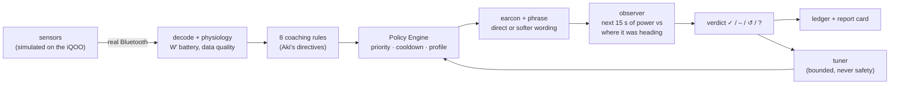

# velocoach-rs

[](https://github.com/Zakir032002/velocoach/actions/workflows/ci.yml)

**Closed-loop voice coach in Rust that measures whether its own cues work — demo runs
hardware-in-the-loop over real BLE between two phones with SIMULATED sensors (no real
rider/sensor data).**

> **At a glance**
> - A cycling voice coach that **decides what to say, says it, then checks whether it
>   worked**. Every cue gets a verdict from the power data: complied, partial, ignored,
>   reversed, or "can't tell" when something else could explain the change.
> - **On real phones** (iPhone 12 coach, iQOO rig, real Bluetooth): a packet is decided on in
>   **p99 238 µs** (target < 1 ms), and the phone's recorded ride **replays identically** on
>   the Mac.
> - **In simulation:** 10 workouts, 149 decisions, 0 corrupt packets. 208 tests and 6 fuzzers
>   (~1.3 billion inputs, 0 crashes). The same seed gives a byte-identical log on Linux and
>   macOS.
> - **Open problems, reported rather than hidden:** the self-check credits itself on 8 of 13
>   ignored cues, and the ground-truth test E1 gives 15/20 seeds against a target of 18/20.
>   Sensor-to-sound latency (T0→T3) is pending, and earbud latency is not measured.
> - **Human pilot: planned, pre-registered, not yet run** ([STUDY.md](STUDY.md)).

[What's built](#whats-built) · [Results](#results) · [Status](#status) ·
[Explained from zero](docs/EXPLAINED.md) · [Every feature](docs/WHAT_WE_BUILT.md) ·
[EFFICACY.md](docs/EFFICACY.md) · [LATENCY.md](docs/LATENCY.md) · [design PDFs](docs/design/)

---

## The idea

Coaching apps talk to riders, but none of the products the plan surveyed measures **whether
each instruction worked**. Aki Kakko's posts describe a coach built from directives, a
separate Policy Engine, context profiles and earcon-first alerts. His Closed-Loop post names
what is missing: a real-time observer that evaluates whether the intervention shifted the
athlete. velocoach implements that design with his names and numbers, and adds the observer.



## What's built

| Feature | What it does on a ride | Crate |
|---|---|---|
| Sensor decoding | reads standard Bluetooth power, heart-rate and cadence packets; rejects corrupt ones without crashing | `vc-gatt` |
| Physiology | the W′ "battery" (how much hard effort is left), cadence, heart-rate drift, data quality (fresh / stale / lost) | `vc-physio` |
| 8 coaching rules | surge countdown, soft-pedal warning, grey-zone drift, W′ low, cadence low, cardiac drift, heart-rate safety, sensor dropout | `vc-core` |
| Priorities | safety and countdowns (P1) override everything and are never muted; coaching (P2/P3) waits its turn and never talks over another cue | `vc-core` |
| Two wordings | each coaching cue has a direct phrasing ("Ease off now, your reserve is at twenty") and a softer one ("Ease off now, or save it for later?") | `vc-core` |
| Self-check (observer) | after every cue, compares the next 15 s of power with where power was already heading: complied, partial, ignored, reversed, or "can't tell" (a hill, coasting, bad data, another cue) | `vc-efficacy` |
| Learning (tuner) | if a rider responds better to the softer wording, switches to it; adjusts cooldown and countdown only inside Aki's ranges; can never touch safety | `vc-efficacy` |
| Ledger and replay | every decision and verdict is one JSON line; a recorded phone ride replays on the Mac identically | `vc-core`, `vc-report` |
| Study mode | randomised wording plus silent "sham" cues (direct 40 % / softer 40 % / sham 20 %), so the coach's effect can be measured fairly; tuner frozen | `vc-core` |
| Report card | per-ride HTML summary with statistics, always labelled with what the data is: SIMULATED DATA, persona, seed, observer version | `vc-report` |
| Rider simulator | simulated riders ("personas") with known behaviour, so the self-check can be graded against the truth | `vc-sim` |
| Phones | the same Rust core runs inside the iPhone coach (Swift) and the Android rig (Kotlin) | `vc-ffi` |

Size: about 17,000 lines of Rust, plus about 2,200 lines of Swift and Kotlin.

## Results

### On real phones (iPhone 12 coach, iQOO rig, real Bluetooth, 2026-10-19)

| What | Result |
|---|---|
| Packet arrives → coach decides (T1→T2), 16-min `dense` ride | **p99 238 µs** (target under 1 ms) |
| The phone's recorded ride replayed on the Mac | **identical** |
| Sensor sent → cue scheduled (T0→T3), with clock-sync bound | pending |
| Cue to the ear (earbud) | not measured |

### One ride, start to finish: `climb_surge` (19 min, simulated rider "Dana")

Each ride runs the complete pipeline: simulated rider and sensors → Bluetooth packet decoders
→ engine → coaching rules → the simulated rider reacts (or not) → the observer scores the
cue → the ledger records it. It is the same Rust code that runs on the iPhone.

| Ride time | What the coach did | What the rider really did | How the coach scored itself |
|---|---|---|---|
| 4:55 | "Surge in five" | – | not scored (a countdown is not a request) |
| 5:00 | "Go now" | started the interval | complied |
| 8:50 | W′ low, direct wording | eased off 1.2 s later | complied, seen 3.0 s after the phrase |
| 9:00 | heart-rate safety cue (overrides everything) | – | not scored (safety is never scored) |
| 11:55 / 12:00 | "Surge in five" / "Go now" | started the interval | complied |
| 14:30 | W′ low again, softer wording | eased off 1.9 s later | complied, seen 3.8 s after the phrase |

7 decisions, 0 corrupt packets, 0 implausible readings. Of the 3.0 s the coach "saw",
1.875 s is the smoothing filter's delay, derived from the filter's definition
((12 − 1)/2 × 250 ms + 500 ms), not fitted.

### The same system on 10 workouts

| Workout | What it shows | Result |
|---|---|---|
| `climb_surge` | intervals, W′, safety | 7 decisions; 4 of 4 scored cues complied |
| `recovery_drift` | soft-pedal and grey-zone coaching, both wordings | 8 decisions; 7 scored, all "complied" (see the next table) |
| `recovery_drift` + HR fault at 847 s | safety overrides coaching | the safety cue cuts off a coaching phrase mid-sentence at 18:03; fault times 846, 847 and 848 s give the same moment |
| `safety_hr` | heart rate climbing past the redline | cardiac-drift cue at 8:24, safety cue at 13:48 |
| `dropout` | the power meter goes silent | "Check power meter connection." at 10:08 |
| `grade_demo` | the road tilts −6 % during the cue | the coach answers **"can't tell (grade)"** instead of crediting itself |
| `grade_confound` | the same cue, after the hill ends | complied |
| `creep_long` (52 min, rider "Sam") | the coach learns: Sam follows direct orders 30 % of the time, softer wording 80 % | at 42:00 the tuner switches Sam's grey-zone cue to the softer wording, after 16 cues (rule T3) |
| `dense` (16 min) | 60 cues back to back (the latency ride) | 60 decisions, all 30 scored complied |
| `creep`, `creep_pilot` | the pilot-study workouts | 13 and 17 decisions |

Across all 10: **149 decisions, 0 corrupt packets, 0 implausible readings; all 5 recorded
reference rides replay byte-identically.**

### Did the coach score itself correctly?

The simulator knows what the rider really did, so each verdict can be checked against the
truth. These are the 51 cues where the simulated rider made a known choice:

| The rider really… | Coach said "complied" | Coach said "can't tell" | Coach said something else |
|---|---|---|---|
| complied (38) | **35** | 1 (the grade cue, correct by design) | 2 ("reversed": wrong) |
| ignored (13) | **8 (wrong)** | 0 | 5 (4 "reversed", 1 "partial") |

When the rider follows a cue, the coach notices 35 times out of 38. When the rider ignores a
cue, the coach still credits itself 8 times out of 13. All of those errors are grey-zone cues
in the slow "creep" workouts, where power drifts by design. **This is an open problem**,
alongside E1 below. It is reported, not tuned away. These are single-seed rides, so the
counts are small.

### The instrument checked against a known rider (E1)

A simulated rider "Calib" complies 70 % of the time with a 3.0 s median reaction, and that is
hidden from the observer. Each seed scores 200 cues.

- **15/20 seeds** are within ±0.08 compliance and ±0.5 s latency.
- On fresh held-out seeds the result is **17/20**.
- The target is **≥ 18/20: not met.**

The first observer scored 0/20. The three corrections made since, and the reason for each, are in
[EFFICACY_CHANGELOG.md](docs/EFFICACY_CHANGELOG.md).

### Engineering quality

| Check | Result |
|---|---|
| Tests | **205** pass in a debug build; **208** with the 3 slow statistical tests (E1 ×2, E8) in release |
| Fuzzing | 6 decoders × 10 min, ~1.3 billion inputs, **0 crashes** |
| Determinism | same seed → byte-identical ledger on Linux and macOS (CI); 5/5 golden rides |
| Safety | property tests: P1 never muted, the tuner can never reach safety, tuned values stay in Aki's ranges |
| Confounders | 6/6 caught through the whole engine; the control ride is not flagged |
| Statistics | with a rider who has no preference, the 95 % interval covers zero in 190/200 runs |
| Embedded | 5 core crates build `no_std` for a Cortex-M4F microcontroller; 0 allocations per packet |
| Both apps | the Android APK builds and the iPhone app compiles on every push |

## Status

One row per success criterion from the plan ([docs/design/](docs/design/)):
*measured-on-hardware* (phone run), *measured-in-simulation* (software, simulated sensors, CI
unless noted), or *pending*. Every row names the test or step that produces it.

| # | Criterion | Status | Result | Named test / CI step | Evidence |
|---|---|---|---|---|---|
| S1 | BLE notify → core decision (T1→T2) p99 < 1 ms, iPhone 12 | measured-on-hardware (2026-10-19) | **p99 238 µs** | phone run, `dense` 16 min | [LATENCY.md](docs/LATENCY.md#s1--ble-notify-to-core-decision-t1---t2) |
| S2 | sensor send → audio scheduled (T0→T3) p99 < 150 ms, with the clock-sync bound | pending | — (bound logic: `the_error_never_exceeds_the_bound`, `a_stamp_finds_its_packet_and_completes_the_cue`) | phone run, `dense` 16 min | [LATENCY.md](docs/LATENCY.md#s2--sensor-send-to-audio-scheduled-t0---t3) |
| S3 | to the ear (T0→T4) reported | pending | **not measured** (generic earbuds) | loopback screen (optional) | [LATENCY.md](docs/LATENCY.md#s3--to-the-ear-t0---t4-not-measured) |
| S4 | ≥ 10 min fuzzing per decoder | measured-in-simulation (local run, 2026-10-16) | 6 targets × 601 s, 0 crashes (hrm 231.6 M, cpm 162.1 M, csc 299.7 M, telem 305.3 M, ctrl 296.0 M, vcsim 0.49 M executions) | `scripts/fuzz-all.sh 600`; CI "Fuzz smoke tests"; `decoders_never_panic` | [ENGINEERING_NOTES.md](docs/ENGINEERING_NOTES.md#fuzzing) |
| S5 | golden logs byte-identical; device capture replays | measured-in-simulation; device replay measured-on-hardware (2026-10-19) | 5/5 golden rides; the iPhone's `dense` capture replays identically | CI "Check golden logs"; `a_captured_ride_replays_identically` | [golden/](golden/) |
| S6 | 60-min soak ×2, no unrecovered failure | pending | — | `soak` scenario + `vc-cli soak-check` | [PHONE_CHECKLIST.md](docs/PHONE_CHECKLIST.md#4-latency-and-soak-runs-the-s-rows-of-the-status-table) |
| S7 | phrase lint 100 % | measured-in-simulation | every phrase passes | `lint_every_phrase_passes_its_profile` | `crates/vc-core/src/phrase.rs` |
| S8 | `no_std` core | measured-in-simulation | 5 crates build for `thumbv7em-none-eabihf` | CI "Build no_std crates for Cortex-M4F" | [below](#crates) |
| S9 | policy and safety properties | measured-in-simulation | P1 never muted; Group never speaks P2/P3; safety within one tick | `p1_is_never_muted`, `group_never_speaks_p2_or_p3`, `safety_fires_within_one_tick_after_120_s` | `crates/vc-core/tests/policy_props.rs` |
| S10 | zero allocations per ingest/tick, ledger included | measured-in-simulation | 0 | `ten_thousand_ingests_and_ticks_after_warm_up_allocate_nothing` | `crates/vc-core/tests/alloc.rs` |
| E1 | observer recovers a known rider (Calib 0.70 / 3.0 s) | measured-in-simulation | **criterion not met:** 15/20 seeds within tolerance (seeds 4,5,8,12,17 fail); held-out 17/20 (seeds 1003,1005,1013 fail) | `e1_development_seeds`, `e1_held_out_seeds` (regression guards at the measured level) | [EFFICACY.md](docs/EFFICACY.md#e1-the-observer-recovers-a-known-rider--criterion-not-met), [changelog](docs/EFFICACY_CHANGELOG.md) |
| E2 | every confounder → Confounded, through the Engine | measured-in-simulation | 6/6, control not confounded | `e2_every_confounder_reaches_the_verdict`, `the_control_ride_is_ignored_not_confounded` | [EFFICACY.md](docs/EFFICACY.md#e2-every-confounder-is-caught-through-the-full-engine) |
| E3 | the tuner cannot reach safety | measured-in-simulation | holds | `e3_tuning_never_reaches_safety` | [EFFICACY.md](docs/EFFICACY.md#e3e4-the-tuners-reach) |
| E4 | tuned parameters stay inside Aki's ranges | measured-in-simulation | holds | `e4_tuned_parameters_stay_inside_akis_ranges` | [EFFICACY.md](docs/EFFICACY.md#e3e4-the-tuners-reach) |
| E5 | observer update: 0 allocations | measured-in-simulation | 0 | `ten_cues_over_ten_minutes_allocate_nothing` | `crates/vc-efficacy/tests/alloc.rs` |
| E6 | same seed → byte-identical ledger, two OSes | measured-in-simulation | Linux = macOS = golden | CI "E6 byte-identical ledger"; `same_seed_and_cues_give_identical_rides_and_records` | [golden/creep_study_11.jsonl](golden/creep_study_11.jsonl) |
| E7 | human-mode demo on video | pending | — | scene D6 | [WHAT_WE_BUILT.md](docs/WHAT_WE_BUILT.md#3-the-demo-scenes-one-feature-each) |
| E8 | null persona: 95 % CI covers 0 in 92–98 % | measured-in-simulation | 190/200 = 95.0 % | `e8_the_null_persona_covers_zero` | [EFFICACY.md](docs/EFFICACY.md#e8-the-statistics-with-a-null-rider) |
| M1 | pre-registered before the first counted session; hash on every record | measured-in-simulation (CI) | STUDY.md at `92aa968`, app hash matches | CI "M1 protocol hash" (`scripts/check-protocol-hash.sh`) | [STUDY.md](STUDY.md) |
| M2 | arm frequencies in bounds; allocation replays from the seed | measured-in-simulation (simulated study run); pilot pending | PASS on 158 simulated decision points | `vc-report --audit`; `p1_is_never_randomised_and_every_p2_has_a_draw` | [docs/sim-study/report.html](docs/sim-study/report.html) |
| M3 | 0 P1 records with an arm | measured-in-simulation; pilot pending | 0 | audit M3; `p1_is_never_randomised_and_every_p2_has_a_draw` | same |
| M4 | one `policy_hash` across Study sessions (tuner frozen) | measured-in-simulation; pilot pending | 1 | audit M4; `study_and_replay_freeze_the_tuner` | same |
| M5 | ≥ 90 % valid; p95 sync bound ≤ 15 ms | measured-in-simulation (bound 0 µs offline); pilot pending | 100 % | audit M5 | same |
| M6 | published figures regenerate from committed ledgers | measured-in-simulation (simulated study run); pilot pending | byte-identical | CI "Simulated study run regenerates", "M6" | [data/sim-study/](data/sim-study/) |
| M7 | mandatory labels present | measured-in-simulation (CI) | present | CI "M7 mandatory labels present" | [STUDY.md](STUDY.md) |
| M8 | written consent before a participant's first session | pending | no participants yet | — | [STUDY.md § Consent](STUDY.md#consent-read-and-signed-before-a-participants-first-session) |

The simulated study run puts the pre-registered protocol through the full pipeline in
software, with personas instead of people. It tests the pipeline. It is not data about people
and not evidence of efficacy.

## How it works

A sans-IO Rust core: it receives bytes and times, and returns at most one decision per call.
The phones own the radio, the threads and the audio. That is why the same code runs on the
Mac, the iPhone and the Android phone, and why any ride can be replayed byte for byte.

<a id="crates"></a>

| Crate | Role | `no_std` |
|---|---|---|
| vc-gatt | GATT decoders (HRM, CPM, CSC) + the rig protocol | yes |
| vc-physio | W′bal (exact + GoldenCheetah-parity), quality, cadence | yes |
| vc-efficacy | the observer, the ledger, the bounded tuner | yes |
| vc-core | the Engine: directives, Policy Engine, phrases, Study mode, clock sync (does not link `alloc`) | yes |
| vc-sim | the simulated rider, its personas, 11 workouts | yes |
| vc-ffi | UniFFI bindings for Swift and Kotlin | no (std) |
| vc-harness | the headless closed loop (Engine + simulator) | no (std) |
| vc-report | JSONL ledger, statistics, the HTML report card | no (std) |
| vc-cli | headless rides, golden logs, replay | no (std) |

"`no_std`" means exactly this: these five crates build for `thumbv7em-none-eabihf` in CI. Their
own unit tests build with std. The full walkthrough, with diagrams, is in
[docs/EXPLAINED.md](docs/EXPLAINED.md).

## Reproduce

```bash
cargo test --workspace --release                 # all 208 tests
for s in climb_surge recovery_drift safety_hr dropout grade_confound creep dense creep_long grade_demo creep_pilot; do
  cargo run -q --release -p vc-cli -- sim --scenario $s; done
cargo run -q --release -p vc-cli -- golden --check
cargo run -q --release -p vc-cli -- find-interrupt --scenario recovery_drift
cargo test --release -p vc-harness --test e1 -- --nocapture   # E1: prints N/20 and the failing seeds
```

Phones: [docs/STEP_BY_STEP.md](docs/STEP_BY_STEP.md). `scripts/setup-ios.sh` and
`scripts/setup-android.sh` install and build everything (no Android Studio needed). CI builds the
rig APK and compiles the iPhone app on every push.

## Limits and what's next

- Simulated sensors only; one iPhone, one Android phone, generic earbuds.
- The self-check is not yet reliable on ignored cues during slow drifts (8 of 13), and E1 is
  15/20 against 18/20. Compliance figures carry that caveat.
- Compliance is not benefit. Personas are assumptions, not data. No human sessions have been run.

Next: fix the observer's false credits on drifting power and re-run E1; measure T0→T3 on the
phones; run the pre-registered pilot and report it whatever it shows; real riders on real
trainers with the same ledger; FIT-file replay through the same engine.

## Credits

velocoach-rs responds to, and operationalises, ideas from Aki Kakko's posts on the Alphanome
Knowledge Hub. It is not endorsed by Aki Kakko or Domesly. Dates are `article:published_time`
in UTC:

- [The Adaptive Architecture: Solving Audio Fatigue and Context Shift in Real-Time Outdoor Cycling Coaching](https://www.alphanome.ai/post/the-adaptive-architecture-solving-audio-fatigue-and-context-shift-in-real-time-outdoor-cycling-coac) — 2026-10-05: the Policy Engine, profiles, earcon-first alerts, the "> 3 seconds" hold.
- [The Static FIT-File Paradox: Closing the Loop Between Static Prescriptions and Real-Time Adaptive Execution](https://www.alphanome.ai/post/the-static-fit-file-paradox-closing-the-loop-between-static-prescriptions-and-real-time-adaptive-ex) — 2026-10-04
- [Algorithmic Calibration of Stimulus Efficiency in Endurance Systems](https://www.alphanome.ai/post/algorithmic-calibration-of-stimulus-efficiency-in-endurance-systems) — 2026-10-03
- [Bridging The Gap Between Static Workout Plans and Live Sensory Stream](https://www.alphanome.ai/post/bridging-the-gap-between-static-workout-plans-and-live-sensory-stream) — 2026-09-28
- [The Psychology of the Soft-Pedal: Overcoming the Cognitive Pause in Endurance Performance](https://www.alphanome.ai/post/the-psychology-of-the-soft-pedal-overcoming-the-cognitive-pause-in-endurance-performance) — 2026-09-02
- [Next-Generation Cycling Technology: A 2026 Industry Analysis](https://www.alphanome.ai/post/next-generation-cycling-technology-a-2026-industry-analysis) — 2026-08-12
- [Investor Analysis: The Active Coaching Category Paradigm](https://www.alphanome.ai/post/investor-analysis-the-active-coaching-category-paradigm) — 2026-08-06
- [Closed-Loop Cybernetic Intelligence in Cycling: Real-Time Active Coaching via Multi-Sensor Fusion and Edge-AI Intervention Architecture](https://www.alphanome.ai/post/closed-loop-cybernetic-intelligence-in-cycling-real-time-active-coaching-via-multi-sensor-fusion-an) — 2026-08-02
- [The Neuro-Psychology of Algorithmic Guidance](https://www.alphanome.ai/post/the-neuro-psychology-of-algorithmic-guidance-attentional-ergonomics-agency-and-stress-dynamics-in): psychological reactance, the reason for the softer-wording arm.

W′bal follows Skiba's differential model as implemented in GoldenCheetah (independent port,
cross-checked: [WPRIME_GC.md](docs/WPRIME_GC.md)). The voice is Piper `en_US-ljspeech-medium`,
trained on the public-domain LJ Speech dataset
([assets/cues/VOICE_LICENSE.md](assets/cues/VOICE_LICENSE.md)). See [THIRD_PARTY.md](THIRD_PARTY.md).

Author: Zakir Shaik. Open-source contributor to RisingWave, Apache Kvrocks and Apache Fury
(since 2024).

## License

MIT OR Apache-2.0, at your option: [LICENSE-MIT](LICENSE-MIT), [LICENSE-APACHE](LICENSE-APACHE).

## Appendix: the VC-SIM rig protocol

Every message starts with a 1-byte version (`0x01`) and a 1-byte opcode. This table is
checked against the encoders by `the_readme_protocol_table_matches_the_encoders`
(`crates/vc-gatt/tests/readme_protocol.rs`): the code is the source of truth.

### Telemetry (VCSIM_TELEM, iQOO → iPhone)

| Message | Opcode | Size | Description |
| :--- | :--- | :--- | :--- |
| `STAMP` | `0x01` | 15 B | T0 of the sensor notification just sent (iQOO clock) |
| `PONG` | `0x02` | 20 B | clock-sync reply: PING received / PONG sent |
| `STATUS` | `0x03` | 12 B | simulator state and active fault bitmask |
| `RIDER_INPUT` | `0x04` | 14 B | human slider effort, timestamped on the iQOO clock |

### Control (VCSIM_CTRL, iPhone → iQOO)

| Message | Opcode | Size | Description |
| :--- | :--- | :--- | :--- |
| `PING` | `0x10` | 12 B | clock-sync request |
| `LOAD` | `0x20` | 9 B | scenario, persona (0–4), seed, human mode |
| `START` | `0x21` | 2 B | start the ride |
| `STOP` | `0x22` | 2 B | stop the ride |
| `FAULT` | `0x30` | 10 B | inject a fault (dropout, garbage, disconnect, coast, HR redline, W′ mismatch) |
| `CLEAR` | `0x31` | 3 B | clear faults (`0xFF` clears all) |
| `RATE` | `0x40` | 4 B | sensor rate |
| `CUE_PLAYED` | `0x50` | 15 B | a cue's ask, arm and audio timing |
