# velocoach, explained from zero

This page explains the whole project, assuming you know nothing. Read it top to bottom once.
The diagrams are drawn by GitHub; open this file on github.com to see them as pictures.

**Contents**

1. [The project in one minute](#1-the-project-in-one-minute)
2. [Why this project, for whom](#2-why-this-project-for-whom)
3. [Objectives: what "done" means](#3-objectives-what-done-means)
4. [The physical setup](#4-the-physical-setup)
5. [The life of one cue, start to finish](#5-the-life-of-one-cue-start-to-finish)
6. [The building blocks (the code)](#6-the-building-blocks-the-code)
7. [How each part works, with examples](#7-how-each-part-works-with-examples)
8. [Modes, personas, scenarios](#8-modes-personas-scenarios)
9. [Every output the project produces](#9-every-output-the-project-produces)
10. [The tests and what each one proves](#10-the-tests-and-what-each-one-proves)
11. [Honest status](#11-honest-status)
12. [Scenario walkthroughs (what you see, what happens inside)](#12-scenario-walkthroughs)
13. [Questions Aki might ask, and the answers](#13-questions-aki-might-ask-and-the-answers)
14. [Where everything is in the repository](#14-where-everything-is-in-the-repository)
15. [Glossary](#15-glossary)

---

## 1. The project in one minute

**What it is:** a **voice coach for cycling**, written in **Rust**. While you ride, it listens
to your sensors (heart rate, power, pedalling speed) and speaks short instructions into your
earbuds, like *"Ease off now, your reserve is at twenty."*

**What makes it special:** after **every single instruction** it checks whether you actually
did what it said. It watches your power for the next 15 seconds and gives that instruction a
**verdict**:

```
"Ease off now, your reserve is at twenty."  →  ✓ complied in 3.0 s
"Back off now, you're drifting into tempo." →  – ignored
"Back off now, …" (but the road tilted up)  →  ? confounded (grade) — it refuses to guess
```

So it is a coach that **measures whether its own cues work**. The plan found no public
product that scores every cue like this.

**How it is demonstrated:** we have no real bike sensors. So an **Android phone (iQOO)
pretends to be the sensors and the rider**, and sends real Bluetooth data to an **iPhone 12,
which is the coach**. The Bluetooth is real; the rider and the sensors are **simulated**.

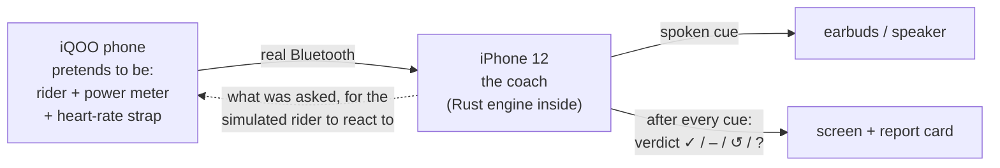

---

## 2. Why this project, for whom

The project was built for **Aki Kakko** at **Domesly** (Alphanome). In his blog posts
(Oct 2026) Aki described how a smart cycling coach should be designed:

- a **state machine** that notices problems (its *directives*, such as `GREY_ZONE_DRIFT`);
- a separate **Policy Engine** that decides *whether* and *how* to speak, with **profiles**
  (Solo / Rolling / Group);
- **earcon-first** alerts (a short tone, then words);
- a **safety rule** that always wins.

His "Closed-Loop" post says open-loop systems lack "a real-time state observer to evaluate
whether the intervention successfully shifted the athlete."

**velocoach builds his design and adds the missing piece: that observer.** It uses his names
and his numbers, then measures every cue. The README credits each post. The wording rule is
that velocoach "responds to" his posts; it never claims he endorsed it.

---

## 3. Objectives: what "done" means

The plan has three layers. Each one starts only after the one below it works.

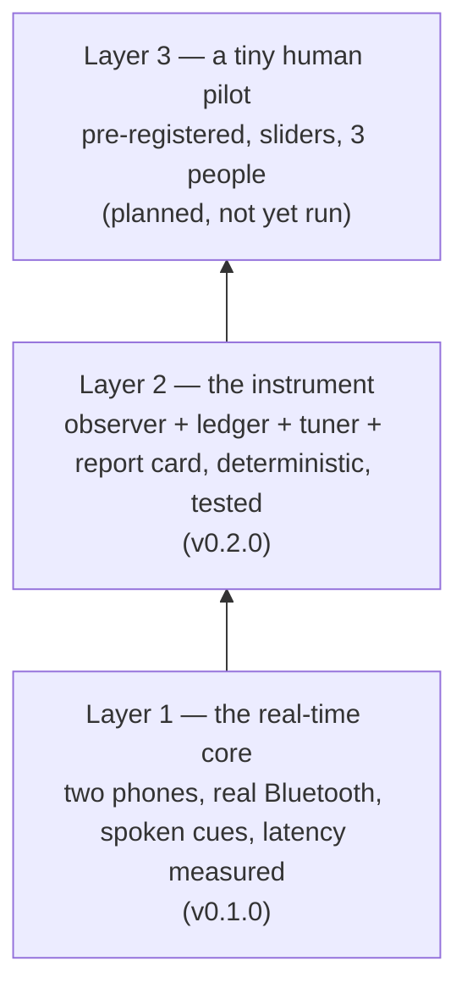

There are 26 success criteria in three families:

| Family | Plain meaning | Examples |
|---|---|---|
| **S — System** | is it fast, robust, correct? | S1 decision in < 1 ms; S2 sensor-to-audio < 150 ms; S4 fuzzing finds no crash; S8 runs on a microcontroller (`no_std`); S10 zero memory allocation per packet |
| **E — Efficacy instrument** | can we trust the verdicts? | E1 the observer recovers a known simulated rider; E2 every confounder is caught; E3 the adaptive code can never touch safety; E8 the statistics are honest |
| **M — Method (study)** | is the pilot done properly? | M1 pre-registered before any session; M3 safety cues never randomised; M8 written consent |

The README **Status** table shows each one: measured on hardware, measured in simulation,
or pending.

---

## 4. The physical setup

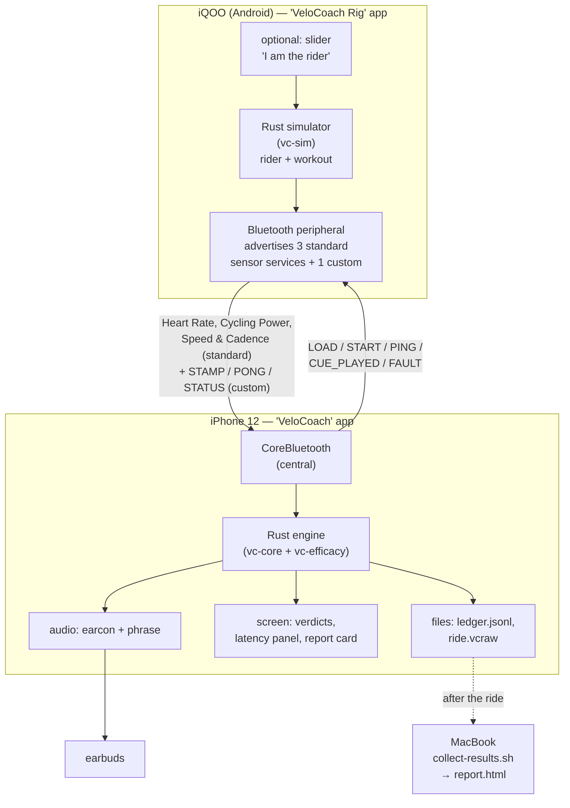

- The **iQOO** runs a Rust **simulator**. It produces exactly the bytes a real Garmin or
  Wahoo sensor would send, over the **standard Bluetooth sensor formats**. The iPhone cannot
  tell the difference.
- The **iPhone** runs the **same Rust engine** that runs on the Mac in the tests. It connects
  to the "sensors", decides, speaks, and scores.
- A small **custom channel** carries control messages (load a workout, start, inject a fault)
  and timing stamps used to measure latency.
- **No iQOO?** The iPhone app has a switch, **In-process simulator (L1)**, that runs the
  simulator inside the iPhone itself, with no radio. It is clearly labelled.

---

## 5. The life of one cue, start to finish

The example is real: scenario `climb_surge`, simulated rider "Dana", at **8 min 49.5 s**.

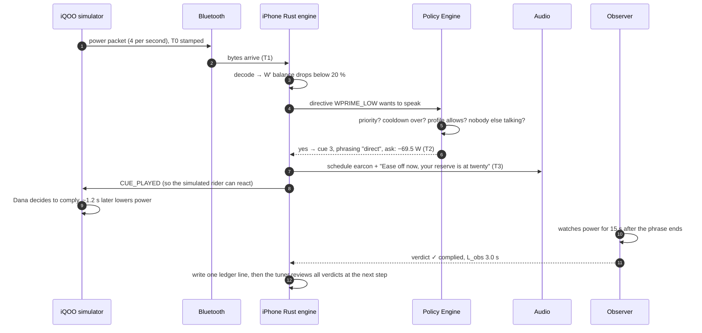

In plain steps:

1. **Sense.** The power meter (simulated) sends a packet 4 times a second.
2. **Decode.** The engine turns bytes into numbers: watts, heart rate, cadence.
3. **Understand.** It updates **W′ balance**, the rider's anaerobic "battery" (section 7.3).
4. **Notice.** A **directive** fires: `WPRIME_LOW` ("the battery is below 20 %").
5. **Decide.** The **Policy Engine** checks the rules: is something more urgent? Is the
   cooldown over? Does the profile allow it?
6. **Speak.** It plays the **earcon** (tone), then the **phrase**.
7. **Watch.** The **observer** compares the next 15 s of power with where power was already
   heading.
8. **Judge.** It gives a **verdict**: ✓ complied, in 3.0 s.
9. **Record.** One line goes into the **ledger** (a log file), with every detail.
10. **Learn.** In Coach mode, the **tuner** may adjust delivery, such as the cooldown or the
    phrasing, but only inside Aki's ranges and never touching safety.

---

## 6. The building blocks (the code)

The Rust code is split into 9 **crates** (packages). The core is **sans-IO**: it never
touches Bluetooth, files, clocks or audio itself. It only receives *bytes + time* and returns
*decisions*. That is why the same code runs on the Mac, the iPhone and the iQOO, and why every
ride can be replayed exactly.

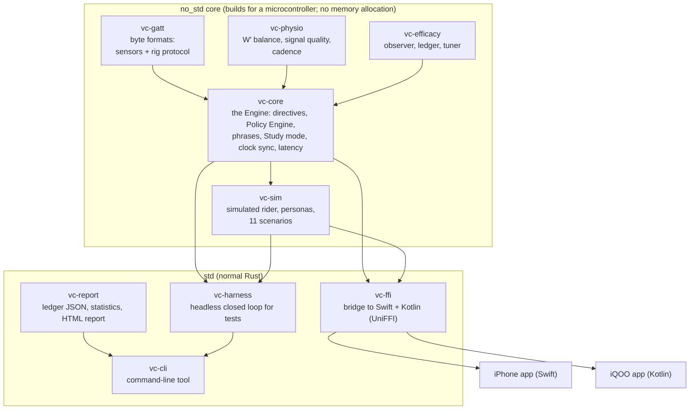

| Crate | One sentence |
|---|---|
| `vc-gatt` | turns sensor bytes into numbers and back, and never crashes on bad bytes (fuzzed) |
| `vc-physio` | the physiology maths: W′ balance, data freshness, cadence |
| `vc-efficacy` | the observer (verdicts), the ledger records, the tuner |
| `vc-core` | the Engine that ties everything together: directives, Policy Engine, phrases, Study mode |
| `vc-sim` | the fake rider: how power, heart rate and cadence evolve, and how a persona reacts to cues |
| `vc-ffi` | exposes the Rust engine to the phone apps |
| `vc-harness` | runs engine + simulator together on a virtual clock, used by the big tests |
| `vc-report` | writes the ledger as JSON lines, computes statistics, renders the HTML report card |
| `vc-cli` | the Terminal tool: run a ride, check golden logs, replay a phone capture |

Size: about 17,000 lines of Rust, plus about 2,200 lines of Swift (iPhone) and Kotlin (iQOO).

---

## 7. How each part works, with examples

### 7.1 Bluetooth and the rig protocol

The iQOO advertises the **standard** Bluetooth sensor services, so the iPhone reads them like
real sensors:

| Service | What it carries | Rate |
|---|---|---|
| Heart Rate | beats per minute | 1 per second |
| Cycling Power | watts (+ crank revolutions) | 4 per second |
| Speed & Cadence | wheel and crank revolutions | 1 per second |

Plus one **custom service** for the test rig itself:

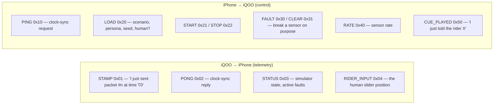

The README's table of these messages is **checked against the code by a test**, so it cannot
go out of date.

### 7.2 Signal quality: only trust fresh data

Every sensor channel has a state:

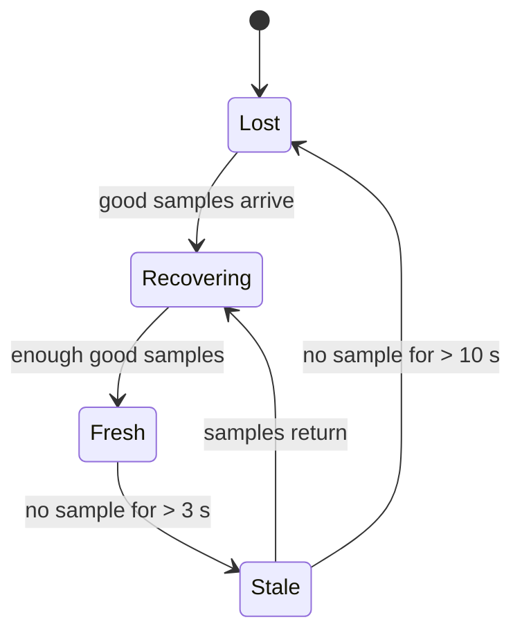

**Rule: only Fresh data may trigger a coaching cue.** If power stays non-Fresh for 5 s, the
coach says *"Check power meter connection."* That is Aki's own phrase.

### 7.3 W′ balance: the rider's battery

**W′** (W-prime) is the energy a rider can spend **above** their sustainable power (CP,
critical power). Our simulated rider has CP = 250 W and W′ = 20,000 J.

- Riding at **320 W** (70 W above CP) drains W′ at about 70 J per second, so a full battery
  lasts about 4.5 minutes.
- Riding **below** CP refills it slowly.
- **W′ balance** (W′bal) is the battery level, from 100 % down to 0 %.

The code has the exact model and a GoldenCheetah-compatible version. The two were
cross-checked with 0.000000 J difference (`docs/WPRIME_GC.md`).

**Example:** in `climb_surge` the rider climbs at 320 W. At 8:49.5 W′bal falls below **20 %**,
so `WPRIME_LOW` fires: *"Ease off now, your reserve is at twenty."*

### 7.4 Directives: the 8 things the coach watches for

| Directive (Aki's name) | Fires when… | Priority | Example phrase |
|---|---|---|---|
| `SAFETY_HR` | heart rate > 98 % of max for > 120 s | **P1** (always wins) | "Ease right off now, heart rate is too high" |
| `SENSOR_DROPOUT` | power not Fresh for ≥ 5 s | **P1** | "Check power meter connection." |
| `SURGE_PENDING` | an interval starts in 5 s, then at its start | **P1** | "Surge in five" … "Go now" |
| `WPRIME_LOW` | W′ balance < 20 % | P2 | "Ease off now, your reserve is at twenty" |
| `SOFT_PEDAL_WARNING` | in a recovery step, power above the band for longer than the grace time | P2 | "Soft-pedal now, drop it by twenty watts" |
| `GREY_ZONE_DRIFT` | in an easy step, power drifting into tempo (≥ 76 % CP) for longer than the grace time | P3 | "Back off now, you're drifting into tempo" |
| `CADENCE_LOW` | pedalling 10 rpm below target for 8 s | P3 | "Raise your cadence, target ninety" |
| `CARDIAC_DRIFT` | heart rate creeping above the endurance cap | P3 | "Ease the pace, your heart rate is drifting" |

Each P2/P3 cue has **two phrasings**, called **arms**:
- **Direct:** "Back off now, you're drifting into tempo."
- **Autonomy-preserving:** "Back off now, or is tempo the plan?"

Aki's "Neuro-Psychology" post says commands can trigger *reactance* (people resist being
ordered). Comparing the two arms tests that.

### 7.5 The Policy Engine: should it speak now?

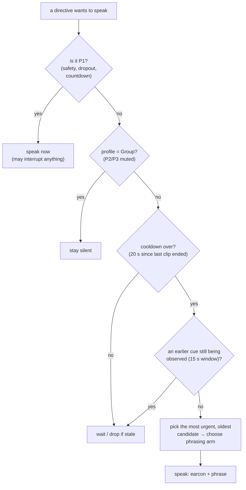

Aki's three **profiles** (his published numbers):

| Profile | Power tolerance | Soft-pedal grace | Grey-zone grace | Talks |
|---|---|---|---|---|
| **Solo** (default) | ±8 % | 5 s | 8 s | standard |
| Rolling | ±15 % | 10 s | 15 s | minimal |
| Group | ±20 % | 15 s | 20 s | minimal, **P2 and P3 muted** |

### 7.6 Phrases and the lint

Every phrase is checked by a **lint** (an automatic rule checker):

- **strict** (P2, P3 and safety): verb first, at most one number, 8–12 syllables.
- **terse** (countdowns): verb first, at most one number, at most 8 syllables.

| Phrase | Lint |
|---|---|
| "Ease off now, your reserve is at twenty" | ✓ verb first, 1 number, 10 syllables |
| "Power high. Ease 40 Watts. Cadence 90." | ✗ noun first, 2 numbers |

The audio is **pre-rendered** with the open-source Piper voice `en_US-ljspeech-medium`, which
is trained on a public-domain dataset. Each cue file is a **tone (earcon) followed by the
words**.

### 7.7 The observer: the heart of the project

**Question:** after a cue, did power move the way the cue asked, more than it would have
anyway?

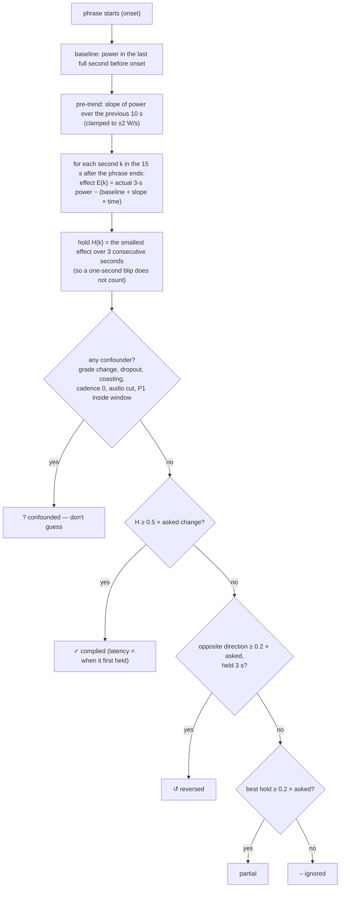

**Worked example** (numbers rounded):

- Rider at **320 W**, steady (slope 0 W/s). The cue asks to **ease off by 69.5 W**.
- *Complied* needs a drop of at least 0.5 × 69.5 = **34.75 W**, held for 3 s.
- *Partial* needs at least 0.2 × 69.5 = **13.9 W**.

| What the rider does in the next 15 s | Verdict |
|---|---|
| drops to 250 W and stays (−70 W) | ✓ **complied** |
| drops to 300 W (−20 W) | **partial** |
| stays at 320 W | – **ignored** |
| surges to 340 W for 3 s (+20 W, wrong way) | ↺ **reversed** |
| drops to 250 W, but the road tilted −6 % at the same time | ? **confounded (grade)** |

**Why the pre-trend matters:** if power was already falling at 1 W/s, it would fall about 15 W
in 15 s with no cue at all. The observer subtracts that, so the cue only gets credit for the
*extra* change.

**Why shams matter:** in Study mode, 20 % of the time the coach decides a cue but **does not
play it**, and scores it anyway. If a "silent cue" is often "complied" too, the cue isn't what
caused the change. This measures the observer's false-positive rate.

**Latency (how fast the rider responded):** `L_obs` = when the effect first held, minus the
end of the phrase. It includes the observer's **smoothing lag**. That lag is **derived from
first principles, not fitted**: the 3-second average of 4-per-second samples has a delay of
(12 − 1)/2 × 250 ms = 1,375 ms, plus 500 ms because the result is stamped at the end of a
1-second bin. Total **1,875 ms**. So in the example, `L_obs` 3.0 s means the simulated rider
reacted about 1.1–1.2 s after the phrase (Dana's true reaction was 1.2 s).

### 7.8 The tuner: the coach adapts (Coach mode only)

The tuner looks at the verdicts collected so far and may change **only** delivery settings,
**only** inside Aki's ranges, and **never** anything about safety. The type system makes that
impossible to get wrong, and property tests check it.

| Rule | Looks at | If… | Then… |
|---|---|---|---|
| **T1** | the surge countdown | riders react slower than the countdown allows | countdown +1 s (max 8) |
| **T1′** | the surge countdown | > 80 % respond within 1 s | countdown −1 s (min 5) |
| **T2** | P2 cues | one is ignored > 50 % of the time | cooldown +10 s (max 45), "too chatty" |
| **T2-P3** | P3 cues | one is ignored > 50 % | give it an earcon |
| **T3** | the two phrasings | one is clearly better (≥ 15 points, ≥ 8 cues each) | make it the default |
| **T4** | P2 cues | > 80 % complied within 2 s | cooldown −10 s (min 15) |

**Real example:** scenario `creep_long`, persona **Sam**. Sam ignores orders but follows
suggestions. At 42:00, after 16 grey-zone cues, the tuner logs:

```json
{"record_type":"tuner_change","rule":"T3","param":"default_variant:GREY_ZONE_DRIFT","from":0.0,"to":1.0,"n":16,"evidence":0.375, ...}
```

That means "switch GREY_ZONE_DRIFT's default from Direct to Autonomy, based on 16 cues,
because autonomy did 37.5 points better."

### 7.9 Latency: how fast is the whole chain?

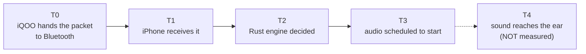

| Measure | Target | What it says |
|---|---|---|
| **T1→T2** (S1) | p99 < 1 ms | the Rust decision is near-instant |
| **T0→T3** (S2) | p99 < 150 ms, ± clock-sync bound | sensor to sound, end to end |
| T3→T4 | — | earbud delay: **not measured**, no number claimed |

The two phones have **different clocks**, so T0 (iQOO) and T1 (iPhone) can't be compared
directly. The iPhone runs **clock sync** (Cristian's method):

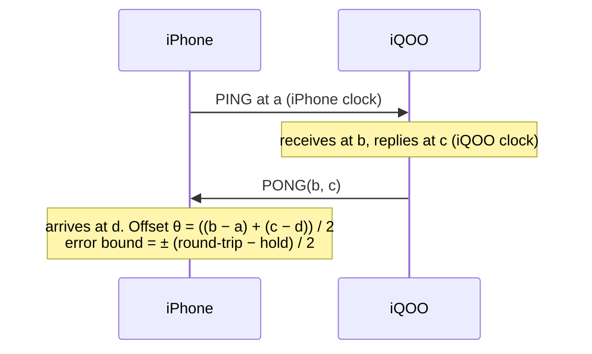

Every latency number carries its **± error bound**, so nothing is overstated.

### 7.10 The ledger and the report card

Every cue becomes **one line of JSON** in the ledger (schema `velocoach.irp.v1`). Here are
the fields of a real line, explained:

| Field | Example | Meaning |
|---|---|---|
| `observer_version` | `vc-efficacy 0.3.0` | which version of the rules scored it (frozen) |
| `mode` | `study` | Coach / Study / Replay |
| `directive` | `GREY_ZONE_DRIFT` | what triggered it |
| `arm`, `is_sham`, `propensity` | `direct`, `false`, `0.4` | which phrasing, and the probability of having picked it |
| `delta_star_w`, `dir` | `13`, `-1` | it asked for 13 W less |
| `pre_trend_slope_w_per_s` | `1.34` | power was already rising 1.34 W/s |
| `verdict`, `latency_ms` | `complied`, `7050` | the result |
| `confound_flags` | `[]` | why it might be "don't know" |
| `t0_ns … t3_ns`, `clock_sync_error_bound_us` | — | the latency chain for this cue |
| `policy_hash`, `protocol_hash` | — | proof the settings didn't change mid-study |

The **report card** (HTML, on the phone and as a file) shows:

- a red **SIMULATED DATA** banner on every page;
- the verdict mix per arm;
- compliance per arm with **Wilson 95 % intervals**;
- **cue minus sham** and **autonomy minus direct**, with **bootstrap** intervals;
- a per-person table, an off-policy "what if" (**SNIPS**), latency, a timeline, and the
  tuner's changes.

**Example from the simulated study run** (`docs/sim-study/report.html`, personas, not
people):

| Arm | Complied | Rate | 95 % interval |
|---|---|---|---|
| direct | 48 / 65 | 0.74 | 0.62–0.83 |
| autonomy | 52 / 61 | 0.85 | 0.74–0.92 |
| sham (no sound) | 22 / 32 | 0.69 | 0.51–0.82 |

**Cue − sham = +0.105, interval −0.08 to +0.30.** The interval includes zero, so the report
honestly says it **cannot** claim cues beat silence on this data. That is the instrument
working as designed.

---

## 8. Modes, personas, scenarios

### Modes

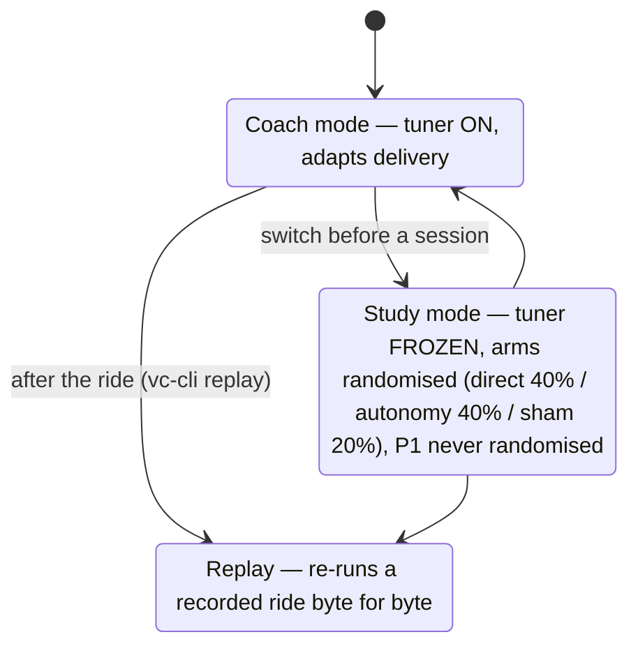

Study-mode allocation per decision point (seeded, so it can be replayed):

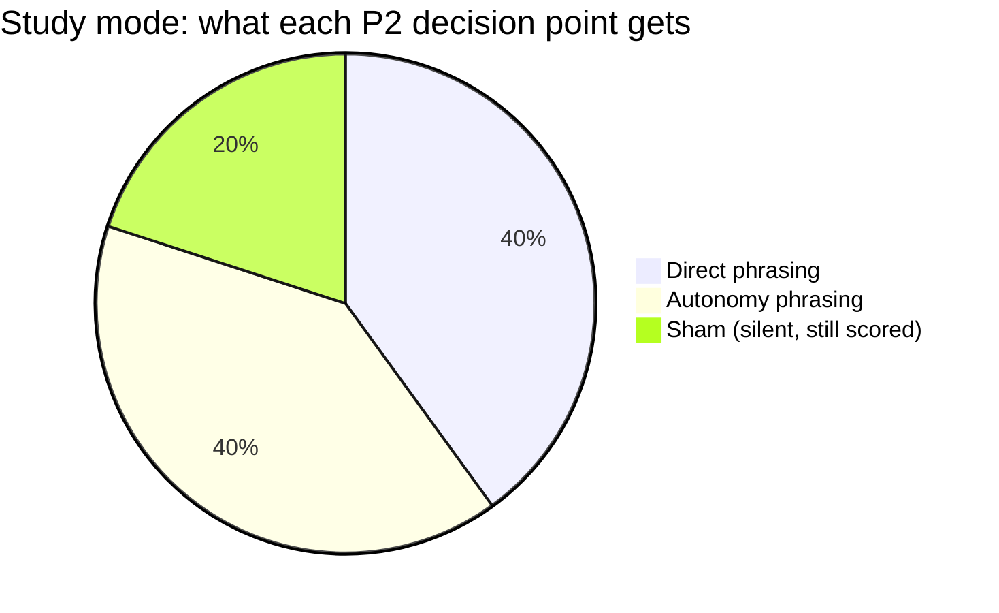

### Personas: the simulated riders

These are labelled assumptions, not data.

| Persona | Obeys Direct | Obeys Autonomy | Typical reaction | Purpose |
|---|---|---|---|---|
| **Dana** | 90 % | 90 % | 1.8 s | a good, responsive rider (demos) |
| **Sam** | 30 % | 80 % | 2.5 s | dislikes orders, likes suggestions; ignores everything when W′ < 10 % (shows the tuner) |
| **Ned** | 50 % | 50 % | 2.5 s | no difference between arms (checks the statistics don't invent effects, E8) |
| **Calib** | 70 % | 70 % | 3.0 s | the "known rider" the observer must recover (E1) |

Every persona also has a 5 % chance of changing power on its own in any 15-s window, which is
what makes shams interesting. **Human mode** replaces the persona with **you** on the iQOO
slider.

### Scenarios: the workouts (11)

| Scenario | Length | What it shows |
|---|---|---|
| `climb_surge` | 19 min | surges, W′-low at 8:50, a safety cue at 9:00 |
| `recovery_drift` | 25 min | soft-pedal, grey-zone drift, both arms; with HR redline at 847 s the safety cue interrupts a phrase at ~18:03 |
| `safety_hr` | 23 min | heart-rate redline → safety cue at 13:48 |
| `dropout` | 23 min | power meter drops → "Check power meter connection." at 10:08 |
| `grade_confound` | 18 min | a gradient change (original version) |
| `grade_demo` | 18 min | the cue at 7:21 is scored "? grade" |
| `creep` | 20 min | slow power creep with Calib (E1 uses it) |
| `dense` | 16 min | a cue every 30 s: the latency measurement ride |
| `soak` | 60 min | robustness run with scripted faults (S6) |
| `creep_long` | 52 min | Sam; the tuner switches phrasing at 42:00 |
| `creep_pilot` | 20 min | the human pilot's workout (slider starts at 70 %) |

---

## 9. Every output the project produces

| Output | Where | What it shows |
|---|---|---|
| Live ride screen | iPhone | link state, step and time, data quality, each cue's verdict badge |
| Latency panel | iPhone | clock sync θ ± bound; T0→T1, T1→T2, T1→T3, T0→T3 percentiles |
| Report card | iPhone, after a ride | the HTML report for that ride |
| Rig status | iQOO | advertising, connected central, packets sent, faults |
| `ledger-*.jsonl` | iPhone files → Mac | one JSON line per cue/event |
| `ride-*.vcraw` | iPhone files → Mac | raw capture; `vc-cli replay` must reproduce the same decisions |
| `soak-*.csv` | iPhone (soak scenario) | robustness log; `vc-cli soak-check` |
| `results/<time>/SUMMARY.md` + `report.html` | Mac (`collect-results.sh`) | replay check, audit, report |
| Golden logs | `golden/*.log` | 5 rides that must stay byte-identical |
| Example report | `docs/examples/creep_study_11.html` | a single study ride |
| Simulated study report | `docs/sim-study/report.html` | the full protocol run with personas |
| Test output | Terminal / GitHub Actions | E1 table, E8 coverage, property tests, fuzzing |
| Rig APK + iPhone build | GitHub Actions | proof both apps build on every change |
| README Status table | GitHub | every criterion and its evidence |

### What a headless ride prints (`vc-cli sim --scenario climb_surge`)

```
#     t_ms   id prio aki directive            arm       phrase earcon
    295000    1 P1   P1  SURGE_PENDING        none      SRG5   ear_p1      ← "Surge in five"
    300000    2 P1   P1  SURGE_PENDING        none      GO     ear_p1      ← "Go now"
    529500    3 P2   P2  WPRIME_LOW           direct    WPL_D  ear_p2      ← "Ease off now…"
    540000    4 P1   P0  SAFETY_HR            none      SAF    ear_p0      ← safety
    ...
cue   3 WPRIME_LOW           direct    -> complied   L_obs  3.0 s
```

---

## 10. The tests and what each one proves

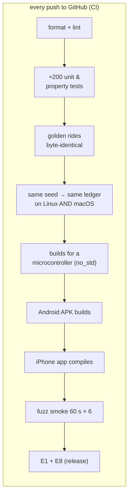

| Test | Proves | Result |
|---|---|---|
| **E1** observer vs known rider (Calib: 70 %, 3.0 s, hidden) | the observer's numbers are close to the truth | **15/20 seeds** within ±0.08 and ±0.5 s; **17/20** on fresh seeds. Criterion ≥ 18/20: **not met** (section 11) |
| **E2** confounders through the whole engine | every "don't know" case is caught | 6/6, and the control ride is *not* flagged |
| **E3** / **E4** property tests | the tuner can never reach safety; its values stay in Aki's ranges | pass on thousands of random histories |
| **E5** / **S10** allocation tests | no memory allocation per packet | 0 |
| **E6** byte-identical ledger | fully deterministic, any OS | Linux = macOS = committed file |
| **E8** null persona (Ned) | the statistics don't invent effects | 95 % intervals cover 0 in 190/200 runs (95.0 %) |
| **S4** fuzzing | no crash on any byte sequence | 6 decoders × 10 min, ~1.3 billion inputs, 0 crashes |
| **S5** golden logs | behaviour can't drift silently | 5/5 identical |
| **S7** phrase lint | every phrase follows the rules | 100 % |
| **S9** policy properties | P1 never muted; Group never speaks P2/P3; safety within one tick | pass |
| README protocol test | the docs match the code | pass |
| Schema round-trip | the ledger format can't drift | byte-for-byte |

---

## 11. Honest status

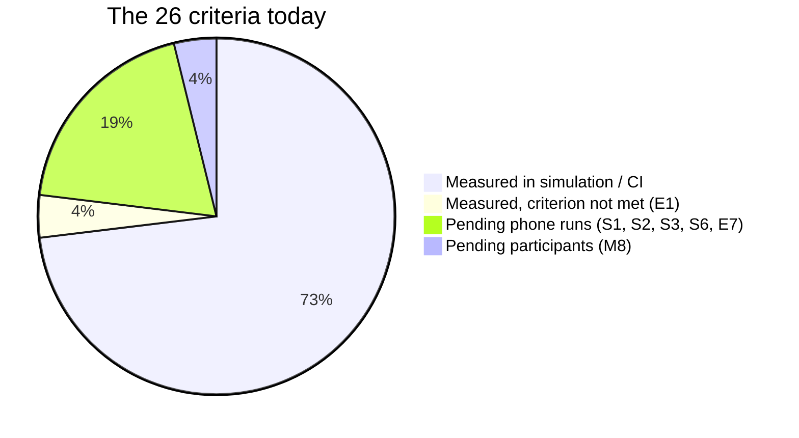

- **Done and measured (software):** everything in section 10 except E1's target.
- **E1 is not met.** The first version of the observer got 0/20. Three corrections were made
  for stated reasons: a derived smoothing lag, a symmetric 3-second hold for "reversed", and
  scoring only cues a rider could react to. Each correction is in
  `docs/EFFICACY_CHANGELOG.md`, and the result was checked on **fresh seeds** to avoid
  fitting: 15/20 and 17/20. The remaining small bias is reported, not hidden. **This
  honesty is a strength:** the instrument reports its own limits.
- **Needs the phones (you):** latency S1/S2, the soak S6, human-mode video E7, on-device
  replay.
- **Earbud latency:** not measured; no number claimed.
- **Human pilot:** planned, pre-registered (`STUDY.md`, protocol hash `92aa968`), **not yet
  run**.
- **Not built (the plan's cut list):** FIT-file replay, Intervals.icu fetch, feedback buttons,
  the decoupling cue, the Mac-as-central fallback, and core-temperature safety (no sensor).

---

## 12. Scenario walkthroughs

### A. "The coach saves the rider's battery" (climb_surge, Dana)
- **You see:** at 4:55 "Surge in five", 5:00 "Go now". At 8:50, a tone and *"Ease off now,
  your reserve is at twenty"*, then **✓ 3.0 s**. At 9:00, the safety cue.
- **Inside:** W′bal crossed 20 % → `WPRIME_LOW` (P2) → the Policy Engine checked the cooldown
  and window → Direct arm → the observer measured a ~70 W drop held for 3 s → complied. Then
  heart rate had been above 98 % of max for 120 s → `SAFETY_HR` (P1).

### B. "Safety beats everything" (recovery_drift, HR redline at 847 s)
- **You see:** a phrase starts and is **cut off** by *"Ease right off now, heart rate is too
  high."*
- **Inside:** the redline held for 120 s → P1 → allowed to interrupt. The interrupted cue is
  marked `audio_interrupted`, so its verdict becomes "confounded" rather than wrong.

### C. "It refuses to guess" (grade_demo)
- **You see:** the cue at 7:21 → **? grade**.
- **Inside:** the gradient changed by more than 3 % inside the 15-s window. A hill can
  change power by itself, so the observer says "don't know".

### D. "A sensor fails" (dropout)
- **You see:** quality goes Stale → Lost, then *"Check power meter connection."* at 10:08,
  then back to Fresh.
- **Inside:** no power packets → the quality state machine → `SENSOR_DROPOUT` after 5 s
  non-Fresh. No performance cue fires on stale data.

### E. "The coach learns" (creep_long, Sam)
- **You see (Terminal):** one `tuner_change` line at 42:00, Direct → Autonomy.
- **Inside:** after ≥ 8 cues per arm, autonomy beat direct by ≥ 15 points → rule T3. It is
  logged with its evidence and is impossible in Study mode.

### F. "You are the rider" (creep_pilot, human mode)
- **You see:** you hold the iQOO slider at 70 %. The power creeps up, a cue says back off,
  you move the slider down, and the badge shows **your** reaction time.
- **Inside:** RIDER_INPUT messages carry the slider position; `L_onset` = your first move
  of ≥ 5 % in the asked direction minus the cue onset. A move within 0.35 s is flagged as a
  coincidence.

### G. "Is the instrument honest?" (Terminal)
- `cargo test --release -p vc-harness --test e1 -- --nocapture` prints the 20-seed table
  with the failing seeds.
- `cargo test --release -p vc-report --test e8 -- --nocapture` shows 190/200.

---

## 13. Questions Aki might ask, and the answers

| Question | Answer |
|---|---|
| "What's new here vs my posts?" | Your posts design the Policy Engine; this adds the **observer**: a verdict per cue, against a pre-trend, with confounders and shams. |
| "Is it real data?" | No. Sensors and rider are **simulated**; the Bluetooth, phones, audio and timing are real. Every report says SIMULATED DATA. |
| "How do you know the verdicts are right?" | E1: a hidden known rider is recovered within tolerance on 15/20 seeds (17/20 held out). The target is 18/20, **not met**, and the changelog says why. |
| "Can the adaptive part break safety?" | No. The tuner's type has no safety field, and property tests (E3) check it on random histories. |
| "How fast is it?" | Decision < 1 ms target; sensor-to-audio < 150 ms target, ± clock-sync bound (your measured numbers go here). Earbud delay is not measured. |
| "Why Rust?" | One deterministic, allocation-free, `no_std` core that runs unchanged on Mac, iPhone, Android and a microcontroller, and replays any ride byte for byte. |
| "Does autonomy phrasing work better?" | Not claimed. The pilot that would test it is pre-registered but not yet run. |

---

## 14. Where everything is in the repository

```
velocoach/
├── crates/            the Rust code (section 6)
├── tools/vc-cli/      the Terminal tool
├── apps/ios/          iPhone app (Swift) + XcodeGen project.yml
├── apps/android/      iQOO rig app (Kotlin, Gradle)
├── assets/cues/       the rendered voice cues (WAV) + VOICE_LICENSE.md
├── golden/            golden rides + the golden ledger
├── data/sim-study/    simulated study ledgers (personas, not people)
├── scripts/           setup-ios.sh, setup-android.sh, collect-results.sh, check-machine.sh, …
├── docs/              everything you read: this file, STEP_BY_STEP, WHAT_WE_BUILT,
│                      EFFICACY, LATENCY, VIDEO_SCRIPT, design PDFs, …
├── STUDY.md           the pre-registered pilot + consent text
└── README.md          the front page + Status table
```

**Which document for what:**

| I want to… | Read |
|---|---|
| understand the project | **this file** |
| do the remaining work | `docs/STEP_BY_STEP.md` |
| know every feature and how to show it | `docs/WHAT_WE_BUILT.md` |
| make the video | `docs/VIDEO_SCRIPT.md` |
| see the observer's maths and E1 in detail | `docs/EFFICACY.md`, `docs/EFFICACY_CHANGELOG.md` |
| see the latency method | `docs/LATENCY.md` |

---

## 15. Glossary

| Word | Meaning |
|---|---|
| **Cue** | one spoken instruction (earcon + phrase) |
| **Earcon** | the short tone before the words |
| **Directive** | a condition that wants a cue (e.g. `WPRIME_LOW`) |
| **Policy Engine** | decides whether/when/how a directive gets spoken |
| **Profile** | Solo / Rolling / Group: Aki's settings for riding context |
| **P1 / P2 / P3** | priority tiers: P1 = safety and countdowns, always wins |
| **Arm** | a phrasing variant: Direct or Autonomy (or Sham = silent) |
| **Sham** | a cue decided but not played, still scored, to measure false positives |
| **Observer** | the part that gives each cue its verdict |
| **Verdict** | complied / partial / ignored / reversed / confounded / invalid |
| **Confounder** | something else that could explain a power change (hill, dropout, …) |
| **Pre-trend** | where power was already heading before the cue |
| **L_obs** | observed latency: when the change first held, minus phrase end |
| **L_onset** | human mode: your first slider move after the cue |
| **Tuner** | adjusts delivery settings from the verdicts (Coach mode only) |
| **Ledger** | the JSONL file: one line per cue |
| **Persona** | a simulated rider with assumed behaviour (Dana, Sam, Ned, Calib) |
| **Scenario** | a simulated workout (`climb_surge`, `dense`, …) |
| **W′ / W′bal** | the rider's above-threshold energy "battery" |
| **CP** | critical power: the rider's sustainable power (250 W here) |
| **GATT / BLE** | Bluetooth Low Energy and its data format |
| **Rig** | the iQOO pretending to be the sensors |
| **sans-IO** | the core never does I/O itself, so it is testable and replayable |
| **no_std** | Rust without the standard library: runs on tiny chips |
| **Golden log** | a saved ride output that must never change unexpectedly |
| **Fuzzing** | throwing billions of random byte sequences at the decoders to find crashes |
| **Property test** | a test that checks a rule on thousands of random inputs |
| **Seed** | the number that makes a "random" run repeatable |
| **CI** | GitHub Actions: runs every check on every push |
| **Pre-registration** | writing the study plan down (and hashing it) before collecting data |
